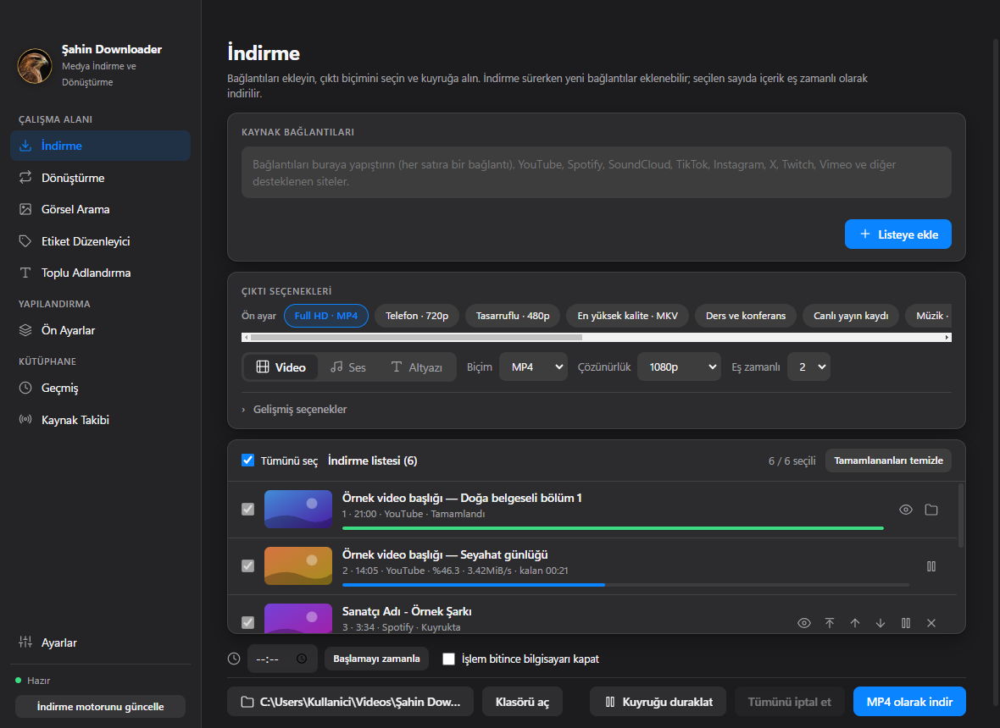
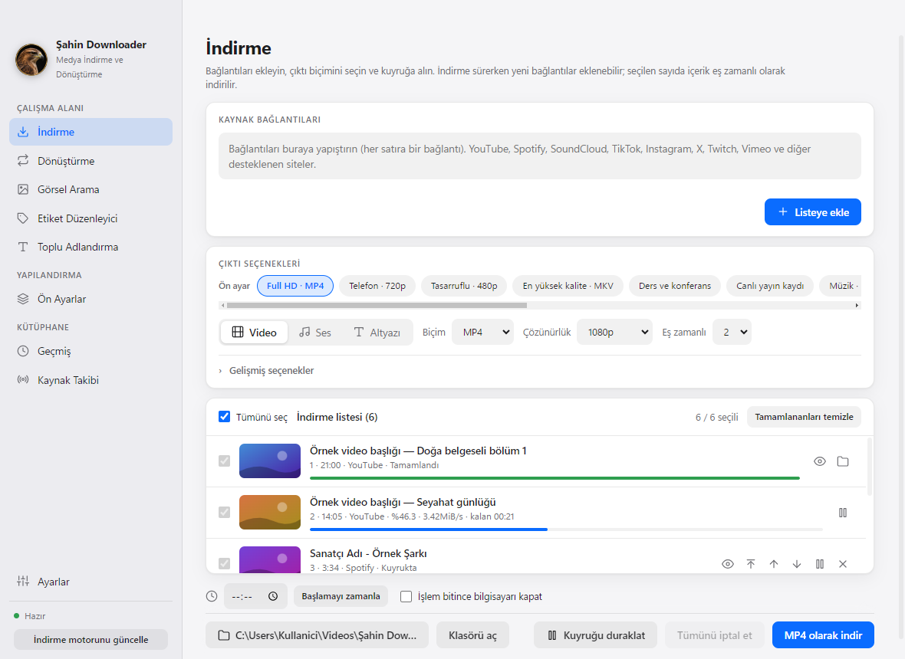
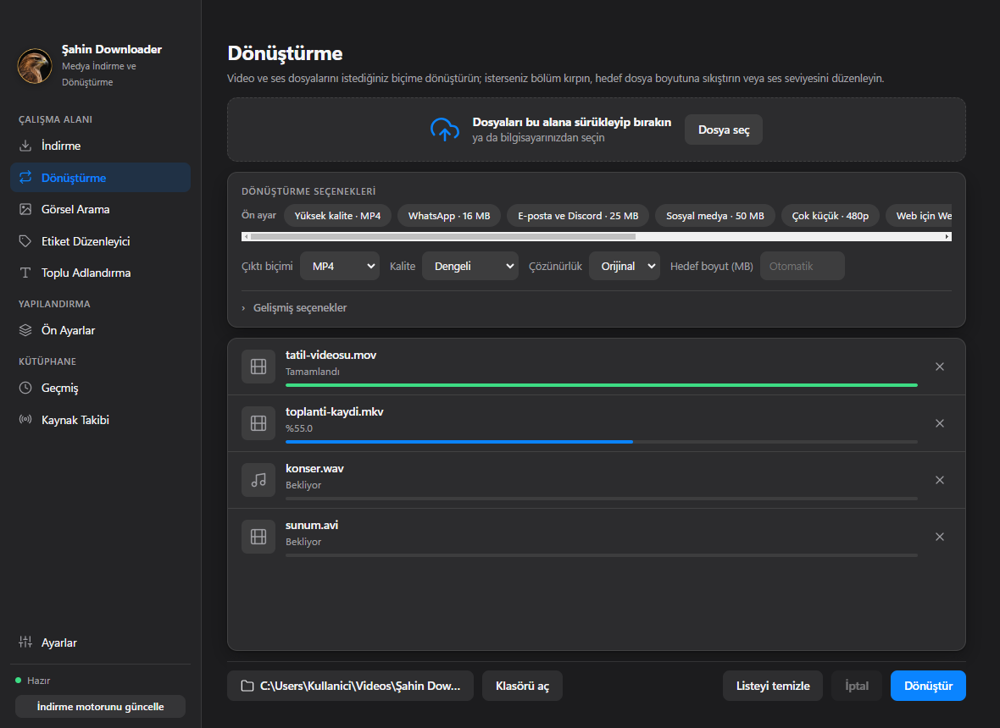
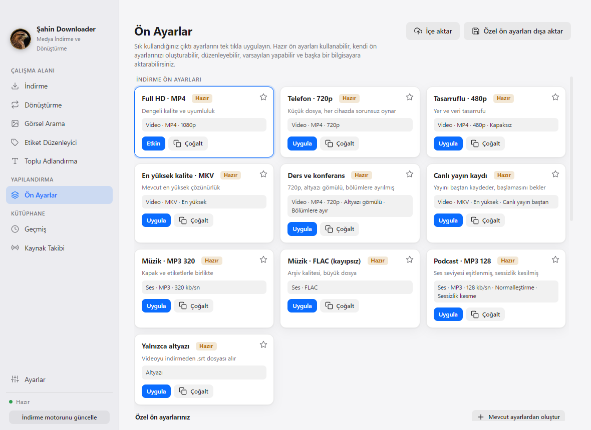
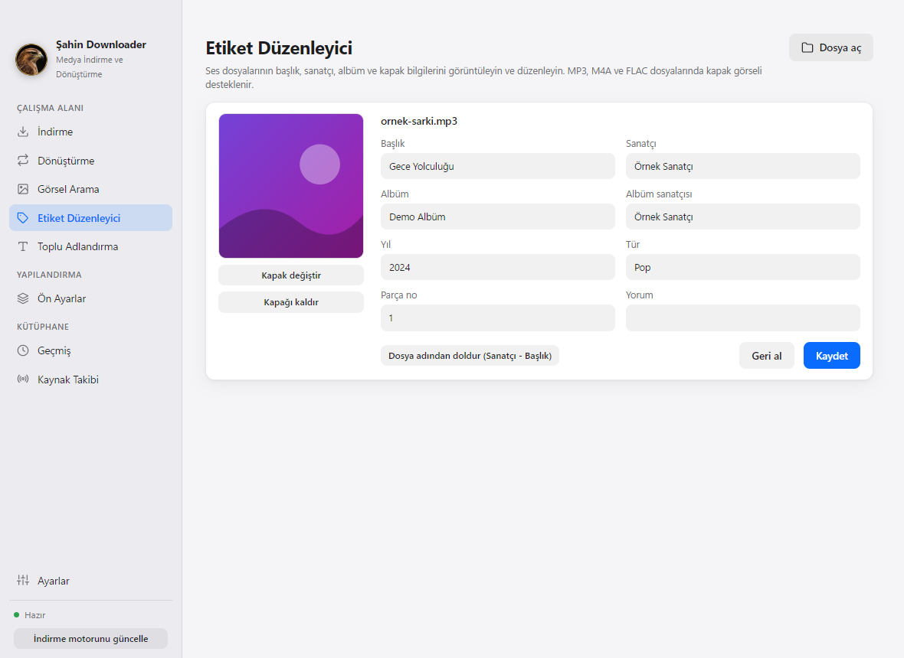
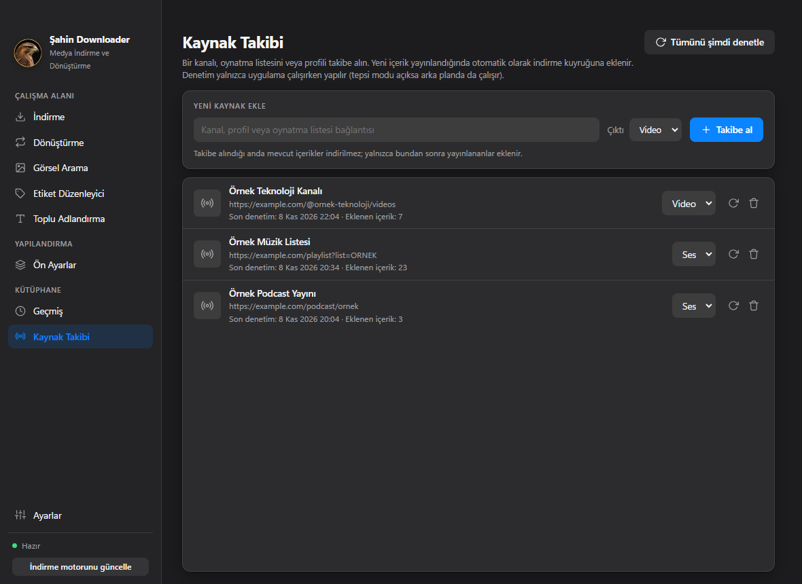
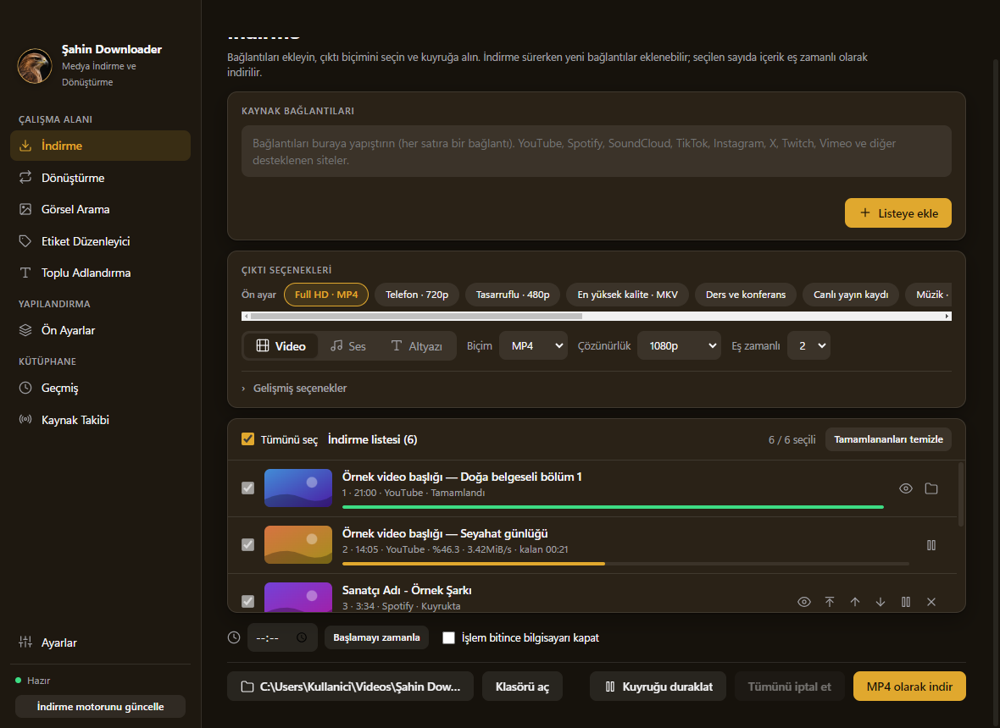
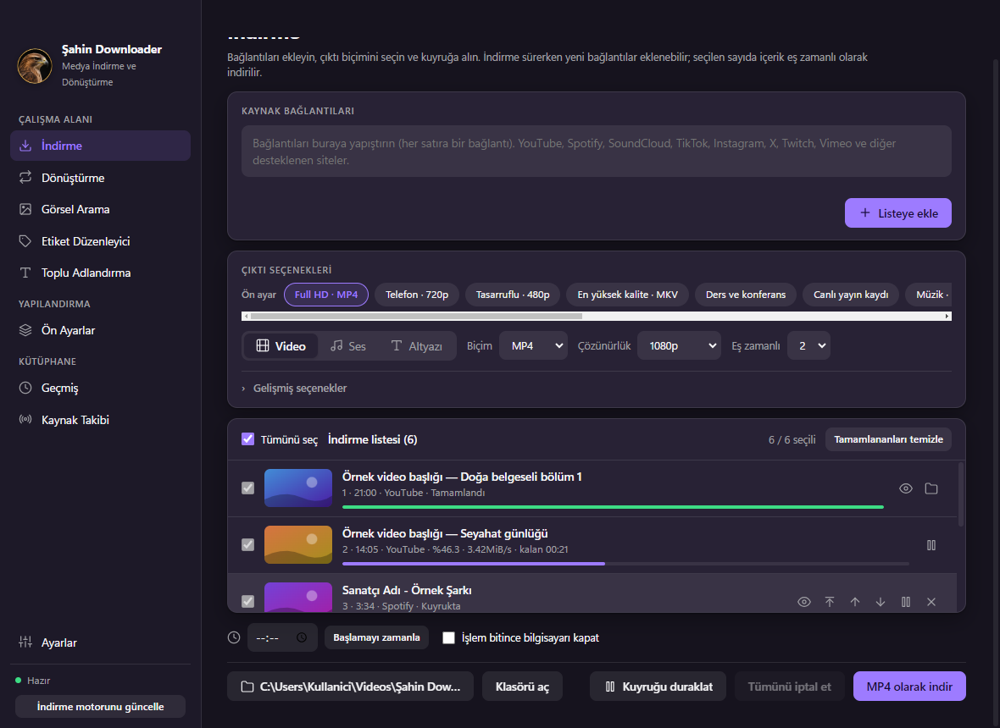
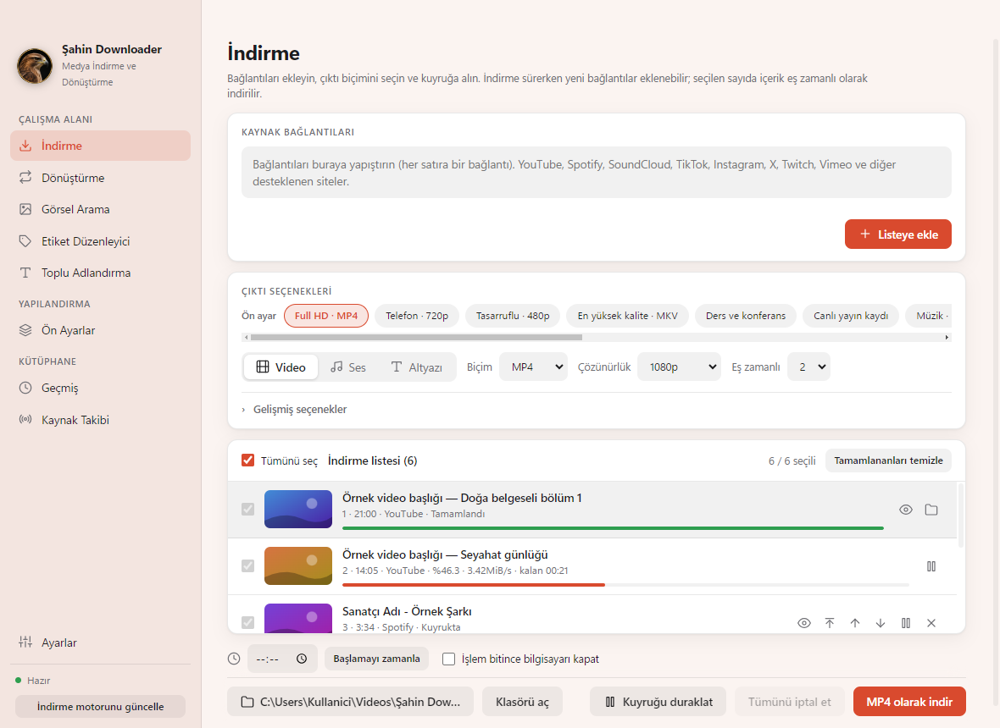
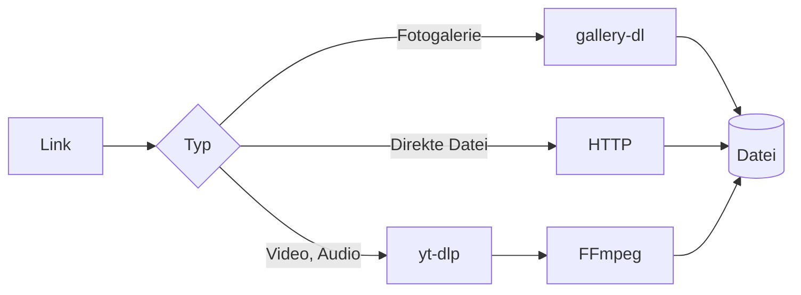

<div align="center">


# Şahin Downloader

**Videos, Audio und Bilder an einem Ort herunterladen. Dateien umwandeln und Tags bearbeiten.**

Eine schnelle Desktop-App für Windows, macOS und Linux, die alles in einem Fenster erledigt. Die Oberfläche ist auf Türkisch.

[Türkçe](README.md) &nbsp;·&nbsp; [English](README.en.md) &nbsp;·&nbsp; [Deutsch](README.de.md)

<br>

[](https://github.com/ugurlutaha07/sahin-downloader/releases/latest) &nbsp; [](https://github.com/ugurlutaha07/sahin-downloader/releases/latest) &nbsp; [](https://github.com/ugurlutaha07/sahin-downloader/releases/latest)

   

<br>



</div>

<br>

## Kurz gesagt

Sie müssen nicht mehr mit einem Programm herunterladen, mit einem zweiten umwandeln und mit einem dritten die Tags korrigieren. Link einfügen, Format wählen, zur Warteschlange hinzufügen, den Rest erledigt die App. Herunterladen, Umwandeln, Taggen und Umbenennen laufen im selben Fenster und in derselben Warteschlange.

<table>
<tr>
<td width="33%" valign="top">

**Herunterladen**<br>
YouTube, Spotify, SoundCloud, TikTok, Instagram, X und Hunderte weitere von yt-dlp unterstützte Seiten. Playlists werden Eintrag für Eintrag aufgelistet, Sie wählen aus.

</td>
<td width="33%" valign="top">

**Umwandeln**<br>
11 Video- und 11 Audioformate. Dateien auf eine **Zielgröße** komprimieren, zum Beispiel 25 MB.

</td>
<td width="33%" valign="top">

**Tags und Umbenennen**<br>
Titel, Interpret, Coverbild. Stapel-Umbenennung mit Vorlagen, mit Vorschau und Rückgängig.

</td>
</tr>
<tr>
<td width="33%" valign="top">

**Warteschlange**<br>
Gleichzeitige Downloads, Pause, Sortieren per Drag-and-drop. Neue Links lassen sich auch während laufender Downloads hinzufügen.

</td>
<td width="33%" valign="top">

**Vorgaben und Quellenverfolgung**<br>
Lieblingseinstellungen mit einem Klick anwenden. Einen Kanal verfolgen, neue Inhalte laden sich von selbst herunter.

</td>
<td width="33%" valign="top">

**In jeder Größe brauchbar**<br>
7 Farbschemata, heller und dunkler Modus. Schaltet in schmalen Fenstern in den Symbolmodus, jede Seite lässt sich scrollen.

</td>
</tr>
</table>

## Herunterladen und installieren

Fertige Pakete finden Sie auf der Seite **[Releases](https://github.com/ugurlutaha07/sahin-downloader/releases/latest)**. Wer das Terminal mag, findet unten den Befehl für jedes System; dafür wird die [GitHub CLI](https://cli.github.com/) (`gh`) benötigt.

<table>
<tr>
<td width="33%" valign="top">

### Windows
`.exe`-Installer oder portable `.zip`.

```powershell
gh release download `
  --repo ugurlutaha07/sahin-downloader `
  --pattern "*.exe"
```

Die heruntergeladene `.exe` ausführen.

</td>
<td width="33%" valign="top">

### macOS
`.dmg`. `arm64` für Apple Silicon, `x64` für Intel.

```bash
gh release download \
  --repo ugurlutaha07/sahin-downloader \
  --pattern "*mac-arm64.dmg"
open Sahin-Downloader-*.dmg
```

Die App in den Ordner *Programme* ziehen.

</td>
<td width="33%" valign="top">

### Linux
`.AppImage` oder `.deb` (64 Bit).

```bash
gh release download \
  --repo ugurlutaha07/sahin-downloader \
  --pattern "*.AppImage"
chmod +x Sahin-Downloader-*.AppImage
./Sahin-Downloader-*.AppImage
```

Für die `.deb`: `sudo apt install ./datei.deb`

</td>
</tr>
</table>

<details>
<summary><b>Wenn beim ersten Start eine Warnung erscheint</b></summary>

<br>

Die Pakete sind noch nicht code-signiert, deshalb kann das Betriebssystem beim ersten Start eine Warnung anzeigen. Der gesamte Quellcode liegt in diesem Repository, Sie können die App auch selbst bauen.

- **Windows:** Im SmartScreen-Dialog *Weitere Informationen* und dann *Trotzdem ausführen* wählen.
- **macOS:** Die App mit Rechtsklick und **Öffnen** starten. Erscheint die Meldung „beschädigt“, im Terminal ausführen:
  ```bash
  xattr -dr com.apple.quarantine "/Applications/Şahin Downloader.app"
  ```
- **Linux:** Es genügt, die AppImage mit `chmod +x` ausführbar zu machen.

</details>

### Aus dem Quellcode starten (Git)

Voraussetzungen: [Git](https://git-scm.com/) und [Node.js](https://nodejs.org/) 20 oder neuer.

```bash
git clone https://github.com/ugurlutaha07/sahin-downloader.git
cd sahin-downloader
npm install
npm start
```

Die Download-Engine (yt-dlp) installiert sich beim ersten Start selbst. Die Galerie-Engine wird bei der ersten Nutzung installiert; ffmpeg ist enthalten.

```bash
npm test            # Unit-Tests (kein Netzwerk und kein ffmpeg nötig)
npm run dist:win    # Windows: Installer (.exe) und portable .zip   (unter Windows)
npm run dist:mac    # macOS: .dmg, arm64 und x64                    (unter macOS)
npm run dist:linux  # Linux: .AppImage und .deb                     (unter Linux)
```

Wird ein Release-Tag gepusht (`git tag v2.0.1 && git push origin v2.0.1`), baut **GitHub Actions** die Pakete für alle drei Systeme und hängt sie an die Releases-Seite an.

## Screenshots

<table>
<tr>
<td width="50%"><br><sub><b>Download</b> · helles Design</sub></td>
<td width="50%"><br><sub><b>Umwandeln</b> · dunkles Design</sub></td>
</tr>
<tr>
<td width="50%"><br><sub><b>Vorgaben</b> · helles Design</sub></td>
<td width="50%"><br><sub><b>Bildersuche</b> · dunkles Design</sub></td>
</tr>
<tr>
<td width="50%"><br><sub><b>Tag-Editor</b> · helles Design</sub></td>
<td width="50%"><br><sub><b>Quellenverfolgung</b> · dunkles Design</sub></td>
</tr>
</table>

<details>
<summary><b>7 Farbschemata</b> (Klassisch, Adler, Ozean, Wald, Sonnenuntergang, Amethyst, Graphit)</summary>

<br>

<table>
<tr>
<td><br><sub>Adler</sub></td>
<td><br><sub>Amethyst</sub></td>
<td><br><sub>Sonnenuntergang</sub></td>
</tr>
</table>

Alle Bilder liegen im Ordner [`docs/screenshots`](docs/screenshots).

</details>

## So funktioniert es



1. **Aufbau.** Die App läuft auf Electron. Der Hauptprozess übernimmt Dateien, Netzwerk und Unterprozesse; die Oberfläche spricht nur über eine sichere Brücke mit ihm. Die Kontextisolierung ist aktiv, die Oberfläche hat keinen direkten Node.js-Zugriff.
2. **Herunterladen.** Je nach Link kommen [yt-dlp](https://github.com/yt-dlp/yt-dlp) für Video und Audio, [gallery-dl](https://github.com/mikf/gallery-dl) für Fotogalerien und HTTP für direkte Dateien zum Einsatz. Die Download-Engine wird beim ersten Start geladen und einmal täglich aktualisiert.
3. **Verarbeitung.** Heruntergeladene Streams werden mit [FFmpeg](https://ffmpeg.org/) zusammengeführt, umgewandelt und zugeschnitten; Cover und Tags werden in die Datei geschrieben.
4. **Datenschutz.** Einstellungen, Verlauf und Verfolgungsliste bleiben auf Ihrem Computer. Die App sendet keine Nutzungsdaten an die Entwickler.

> **Zu Spotify:** Spotify-Inhalte sind durch DRM geschützt und lassen sich nicht direkt herunterladen. Das Audio wird aus einer Quelle bezogen, die zu Titel und Interpret passt; Titel, Interpret und Cover werden in die Datei geschrieben.

<details>
<summary><b>Datenort und Fehlerbehebung</b></summary>

<br>

| System | Einstellungen und Verlauf |
| --- | --- |
| Windows | `%APPDATA%\Şahin Downloader` |
| macOS | `~/Library/Application Support/Şahin Downloader` |
| Linux | `~/.config/Şahin Downloader` |

- **YouTube-Meldung „Anmeldung zur Bestätigung“:** Wählen Sie unter Einstellungen → Kontozugriff eine Browsersitzung. In neueren Chrome- und Edge-Versionen lassen sich Cookies unter Umständen nicht lesen; verwenden Sie dann Firefox oder eine `cookies.txt`.
- **Inhalte von Instagram, X oder LinkedIn lassen sich nicht abrufen:** Diese Seiten verlangen meist eine Anmeldung; nutzen Sie die Sitzungseinstellung oben.
- **Wenn Downloads plötzlich nicht mehr funktionieren:** Seiten ändern sich häufig. Aktualisieren Sie die Download-Engine mit Einstellungen → *Jetzt aktualisieren*.
- **Zielgröße:** Verfügbar für MP4, MKV, MOV, M4V, FLV, TS und Audioformate.

</details>

## Rechtlicher Hinweis

Diese Anwendung darf nur für Inhalte verwendet werden, an denen Sie die Rechte besitzen oder deren Download erlaubt ist. Die Einhaltung der Nutzungsbedingungen der Anbieter und der geltenden Gesetze liegt in der Verantwortung der Nutzer. Die Autoren haften nicht für einen Missbrauch der Anwendung.

## Lizenz und Komponenten von Drittanbietern

Der Code dieses Projekts steht unter der [MIT](LICENSE)-Lizenz. Für die folgenden Komponenten gelten die jeweils eigenen Lizenzen:

| Komponente | Lizenz | Hinweis |
| --- | --- | --- |
| [Electron](https://github.com/electron/electron) | MIT | Enthält Chromium- und Node.js-Komponenten |
| [Node.js](https://nodejs.org/) | MIT | Als JavaScript-Laufzeit für YouTube mitgeliefert |
| [yt-dlp](https://github.com/yt-dlp/yt-dlp) | Unlicense | Wird zur Laufzeit heruntergeladen |
| [gallery-dl](https://github.com/mikf/gallery-dl) | GPL-2.0 | Wird zur Laufzeit heruntergeladen |
| [FFmpeg](https://ffmpeg.org/) (`ffmpeg-static`) | GPL-3.0-or-later | Bei Weitergabe die Lizenzbedingungen beachten |
| [electron-builder](https://github.com/electron-userland/electron-builder) | MIT | Nur zum Erstellen der Pakete |

<br>

---

<div align="center">

## Entwickler

<table>
<tr>
<td align="center" width="50%">

**Taha Uğurlu**<br><br>

[](https://www.linkedin.com/in/taha-u%C4%9Furlu-367229434)
[](https://github.com/ugurlutaha07)

</td>
<td align="center" width="50%">

**Şahin Kerse**

</td>
</tr>
</table>

<br>

Wenn es Ihnen geholfen hat, lassen Sie einen Stern auf dem Repository da. Wenn etwas nicht funktioniert oder Sie eine Idee haben, schreiben Sie auf der Seite **[Issues](https://github.com/ugurlutaha07/sahin-downloader/issues)**.<br>
Viel Spaß beim Herunterladen.

<sub>© 2026 Taha Uğurlu · MIT-Lizenz</sub>

</div>
