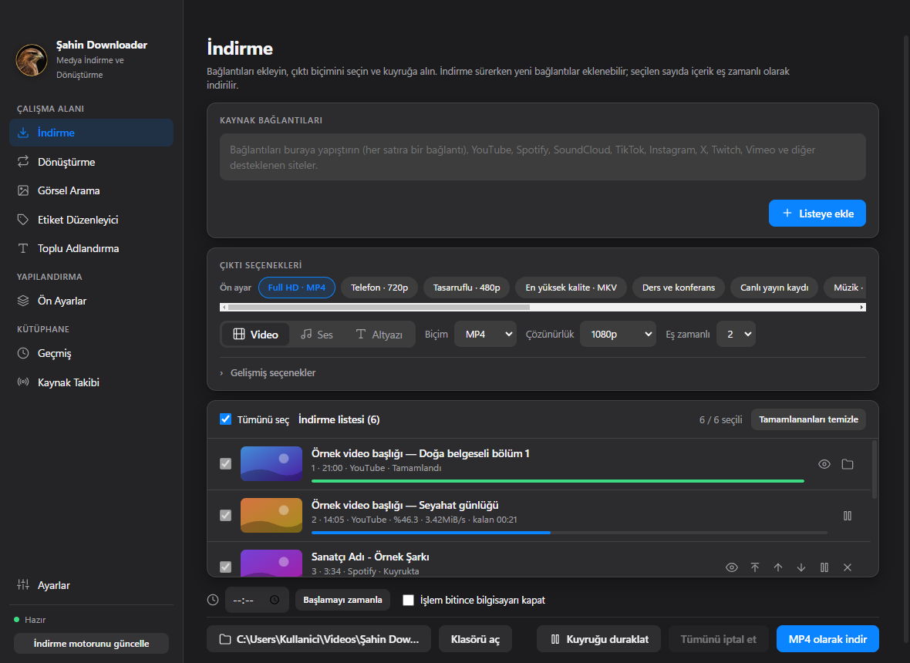
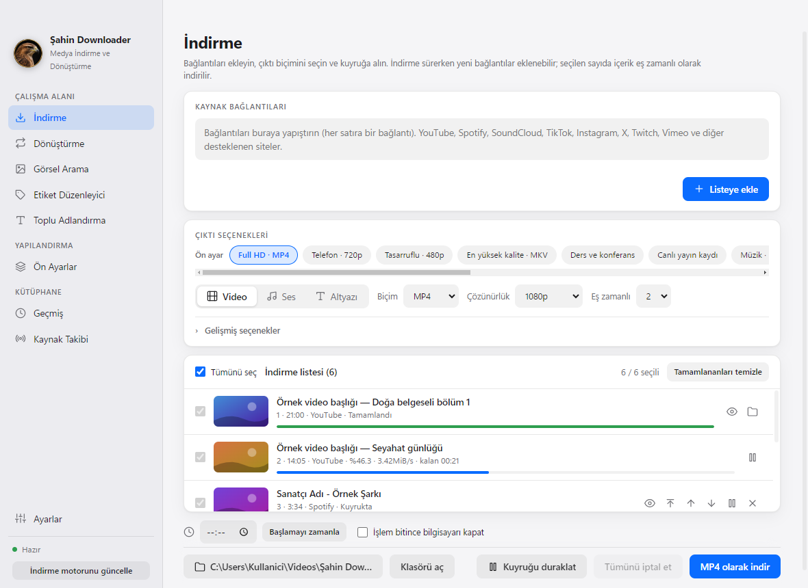
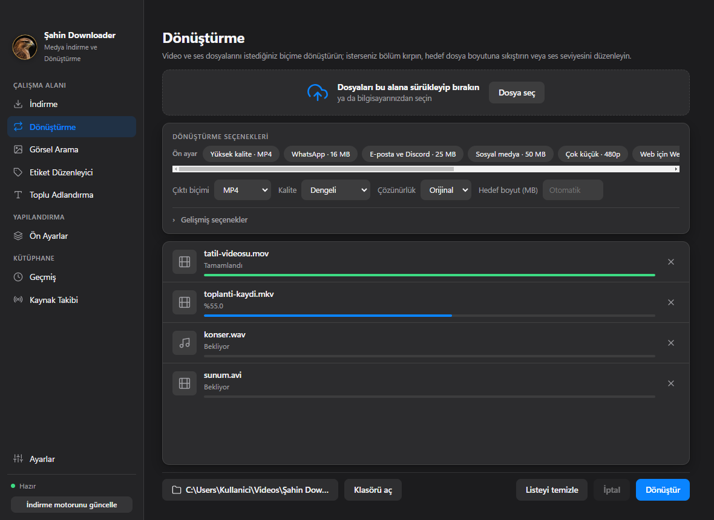
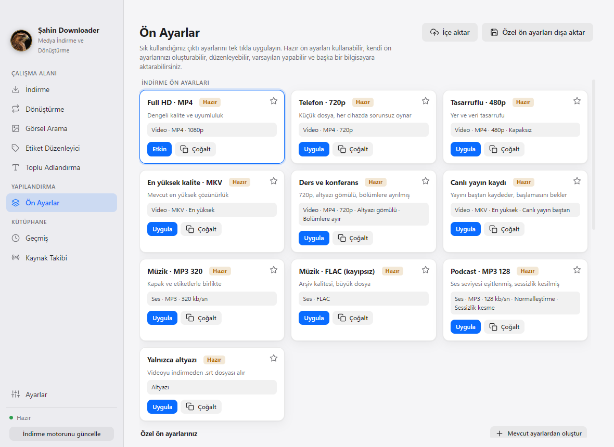
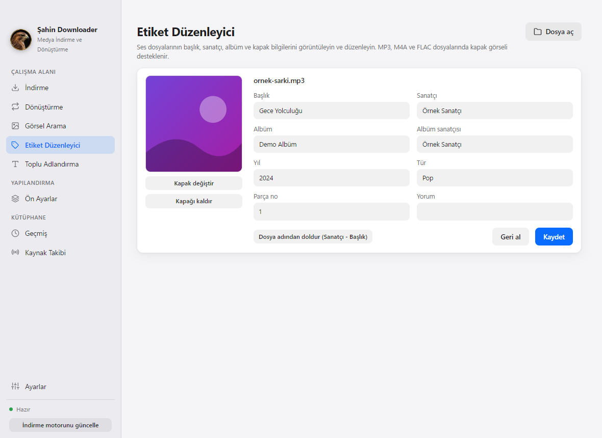
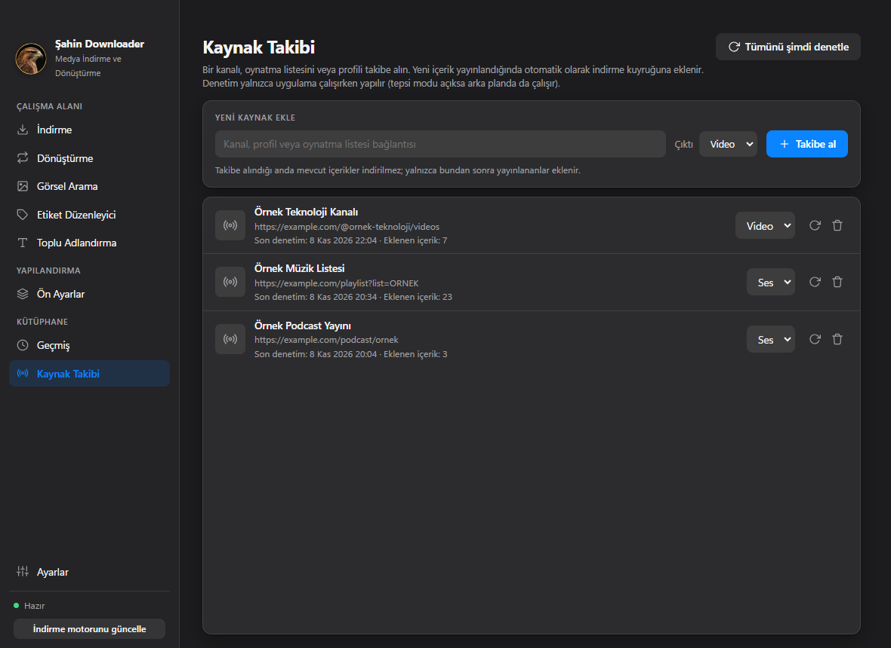
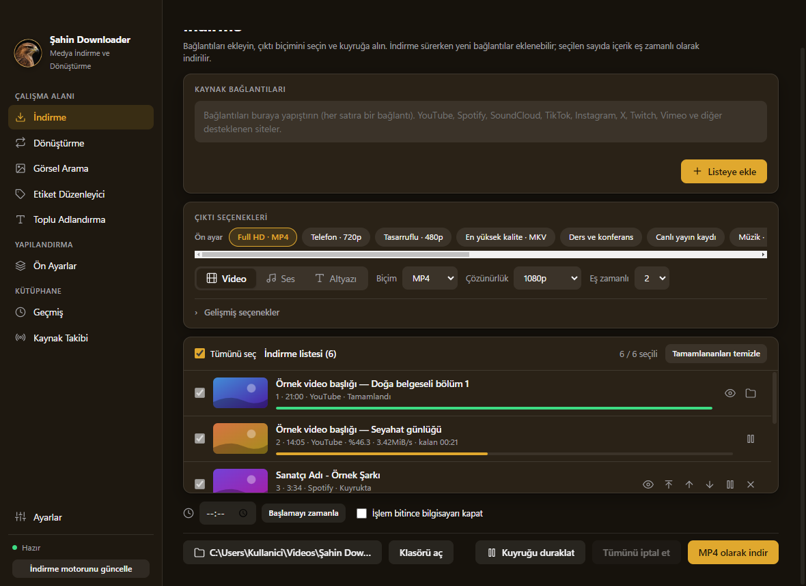
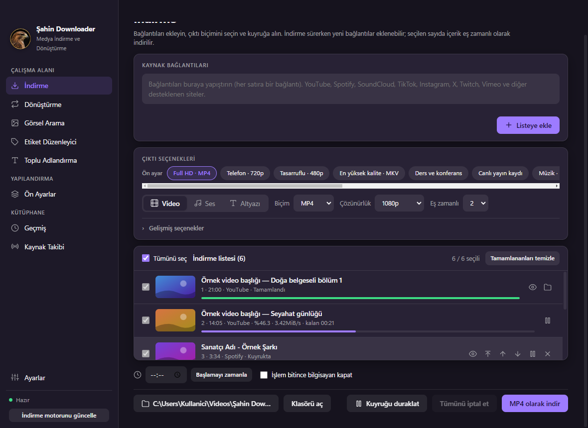
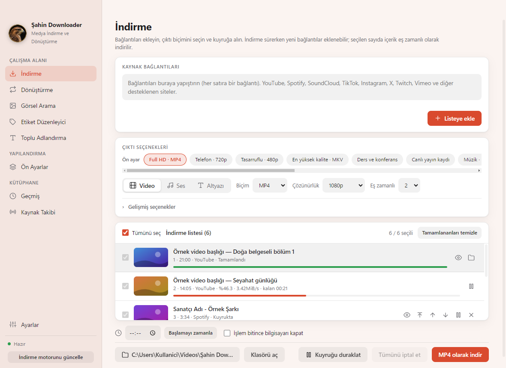
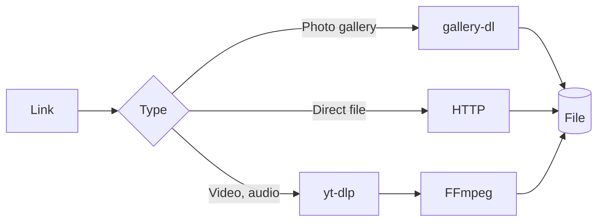

<div align="center">


# Şahin Downloader

**Download video, audio and images in one place. Convert files and edit tags.**

A fast desktop app for Windows, macOS and Linux that does it all in a single window. The interface is in Turkish.

[Türkçe](README.md) &nbsp;·&nbsp; [English](README.en.md) &nbsp;·&nbsp; [Deutsch](README.de.md)

<br>

[](https://github.com/ugurlutaha07/sahin-downloader/releases/latest) &nbsp; [](https://github.com/ugurlutaha07/sahin-downloader/releases/latest) &nbsp; [](https://github.com/ugurlutaha07/sahin-downloader/releases/latest)

   

<br>



</div>

<br>

## In short

No need to download with one tool, convert with another and fix the tags with a third. Paste a link, pick a format, add it to the queue, and the app does the rest. Downloading, converting, tagging and renaming all live in the same window and the same queue.

<table>
<tr>
<td width="33%" valign="top">

**Downloading**<br>
YouTube, Spotify, SoundCloud, TikTok, Instagram, X and hundreds of other sites supported by yt-dlp. Playlists arrive item by item, so you pick what you want.

</td>
<td width="33%" valign="top">

**Converting**<br>
11 video and 11 audio formats. Compress a file to a **target size**, for example 25 MB.

</td>
<td width="33%" valign="top">

**Tags and renaming**<br>
Title, artist, cover image. Batch renaming with templates, with preview and undo.

</td>
</tr>
<tr>
<td width="33%" valign="top">

**Queue**<br>
Concurrent downloads, pause, drag-and-drop ordering. Add new links while downloads are running.

</td>
<td width="33%" valign="top">

**Presets and source tracking**<br>
Apply your favorite settings in one click. Follow a channel and new items download on their own.

</td>
<td width="33%" valign="top">

**Works at any size**<br>
7 color schemes, light and dark mode. Switches to icon mode in narrow windows and every page scrolls.

</td>
</tr>
</table>

## Download and install

Ready-made packages are on the **[Releases](https://github.com/ugurlutaha07/sahin-downloader/releases/latest)** page. If you like the terminal, the command for each system is below; you need the [GitHub CLI](https://cli.github.com/) (`gh`).

<table>
<tr>
<td width="33%" valign="top">

### Windows
`.exe` installer or portable `.zip`.

```powershell
gh release download `
  --repo ugurlutaha07/sahin-downloader `
  --pattern "*.exe"
```

Run the downloaded `.exe`.

</td>
<td width="33%" valign="top">

### macOS
`.dmg`. `arm64` for Apple Silicon, `x64` for Intel.

```bash
gh release download \
  --repo ugurlutaha07/sahin-downloader \
  --pattern "*mac-arm64.dmg"
open Sahin-Downloader-*.dmg
```

Drag the app to *Applications*.

</td>
<td width="33%" valign="top">

### Linux
`.AppImage` or `.deb` (64-bit).

```bash
gh release download \
  --repo ugurlutaha07/sahin-downloader \
  --pattern "*.AppImage"
chmod +x Sahin-Downloader-*.AppImage
./Sahin-Downloader-*.AppImage
```

For the `.deb`: `sudo apt install ./file.deb`

</td>
</tr>
</table>

<details>
<summary><b>If you see a warning on first launch</b></summary>

<br>

The packages are not code-signed yet, so your operating system may show a warning the first time you open the app. The full source code is in this repository, so you can build it yourself.

- **Windows:** In the SmartScreen dialog, choose *More info*, then *Run anyway*.
- **macOS:** Right-click the app and choose **Open**. If you see a "damaged" message, run this in Terminal:
  ```bash
  xattr -dr com.apple.quarantine "/Applications/Şahin Downloader.app"
  ```
- **Linux:** Making the AppImage executable with `chmod +x` is all it takes.

</details>

### Run from source (Git)

Requirements: [Git](https://git-scm.com/) and [Node.js](https://nodejs.org/) 20 or later.

```bash
git clone https://github.com/ugurlutaha07/sahin-downloader.git
cd sahin-downloader
npm install
npm start
```

The download engine (yt-dlp) installs itself on first launch. The gallery engine installs on first use; ffmpeg is included.

```bash
npm test            # unit tests (no network or ffmpeg needed)
npm run dist:win    # Windows: installer (.exe) and portable .zip   (on Windows)
npm run dist:mac    # macOS: .dmg, arm64 and x64                    (on macOS)
npm run dist:linux  # Linux: .AppImage and .deb                     (on Linux)
```

When a release tag is pushed (`git tag v2.0.1 && git push origin v2.0.1`), **GitHub Actions** builds the packages for all three systems and attaches them to the Releases page.

## Screenshots

<table>
<tr>
<td width="50%"><br><sub><b>Download</b> · light theme</sub></td>
<td width="50%"><br><sub><b>Convert</b> · dark theme</sub></td>
</tr>
<tr>
<td width="50%"><br><sub><b>Presets</b> · light theme</sub></td>
<td width="50%"><br><sub><b>Image search</b> · dark theme</sub></td>
</tr>
<tr>
<td width="50%"><br><sub><b>Tag editor</b> · light theme</sub></td>
<td width="50%"><br><sub><b>Source tracking</b> · dark theme</sub></td>
</tr>
</table>

<details>
<summary><b>7 color schemes</b> (Classic, Eagle, Ocean, Forest, Sunset, Amethyst, Graphite)</summary>

<br>

<table>
<tr>
<td><br><sub>Eagle</sub></td>
<td><br><sub>Amethyst</sub></td>
<td><br><sub>Sunset</sub></td>
</tr>
</table>

All images are in the [`docs/screenshots`](docs/screenshots) folder.

</details>

## How it works



1. **Structure.** The app runs on Electron. The main process handles files, networking and child processes; the interface talks to it only through a secure bridge. Context isolation is on and the interface has no direct Node.js access.
2. **Downloading.** Depending on the link, [yt-dlp](https://github.com/yt-dlp/yt-dlp) handles video and audio, [gallery-dl](https://github.com/mikf/gallery-dl) handles photo galleries and plain HTTP handles direct files. The download engine is fetched on first launch and updated once a day.
3. **Processing.** Downloaded streams are merged, converted and trimmed with [FFmpeg](https://ffmpeg.org/); cover art and tags are written into the file.
4. **Privacy.** Settings, history and the follow list stay on your computer. The app does not send data about your usage to the developers.

> **About Spotify:** Spotify content is protected by DRM and cannot be downloaded directly. The audio is taken from a source that matches the track title and artist, and the title, artist and cover art are written into the file.

<details>
<summary><b>Data location and troubleshooting</b></summary>

<br>

| System | Settings and history |
| --- | --- |
| Windows | `%APPDATA%\Şahin Downloader` |
| macOS | `~/Library/Application Support/Şahin Downloader` |
| Linux | `~/.config/Şahin Downloader` |

- **"Sign in to confirm you're not a bot" on YouTube:** Choose a browser session under Settings → Account access. Newer versions of Chrome and Edge may block cookie access; use Firefox or a `cookies.txt` file instead.
- **Instagram, X or LinkedIn content cannot be fetched:** These sites usually require a login; use the session setting above.
- **If downloads suddenly stop working:** Sites change often. Refresh the download engine with Settings → *Update now*.
- **Target size:** Available for MP4, MKV, MOV, M4V, FLV, TS and audio formats.

</details>

## Legal notice

This application must only be used for content you own the rights to or are allowed to download. Complying with content providers' terms of service and applicable law is the user's responsibility. The authors cannot be held liable for misuse of the application.

## License and third-party components

The code of this project is released under the [MIT](LICENSE) license. The licenses of the following components apply separately:

| Component | License | Note |
| --- | --- | --- |
| [Electron](https://github.com/electron/electron) | MIT | Includes Chromium and Node.js components |
| [Node.js](https://nodejs.org/) | MIT | Bundled as the JavaScript runtime for YouTube |
| [yt-dlp](https://github.com/yt-dlp/yt-dlp) | Unlicense | Downloaded at runtime |
| [gallery-dl](https://github.com/mikf/gallery-dl) | GPL-2.0 | Downloaded at runtime |
| [FFmpeg](https://ffmpeg.org/) (`ffmpeg-static`) | GPL-3.0-or-later | Observe the license terms when redistributing |
| [electron-builder](https://github.com/electron-userland/electron-builder) | MIT | Used only for packaging |

<br>

---

<div align="center">

## Developers

<table>
<tr>
<td align="center" width="50%">

**Taha Uğurlu**<br><br>

[](https://www.linkedin.com/in/taha-u%C4%9Furlu-367229434)
[](https://github.com/ugurlutaha07)

</td>
<td align="center" width="50%">

**Şahin Kerse**

</td>
</tr>
</table>

<br>

If it was useful to you, leave a star on the repository. If something breaks or you have an idea, write it on the **[Issues](https://github.com/ugurlutaha07/sahin-downloader/issues)** page.<br>
Happy downloading.

<sub>© 2026 Taha Uğurlu · MIT License</sub>

</div>
