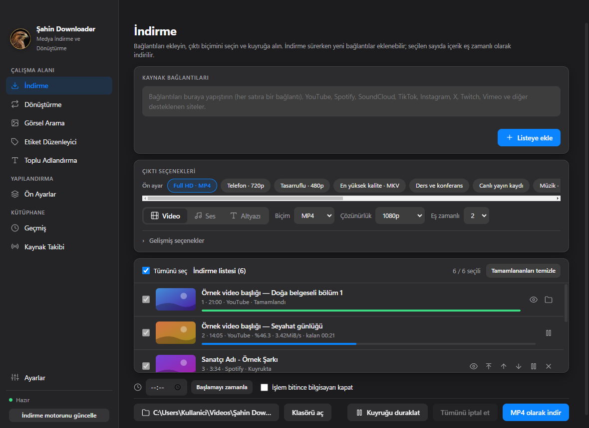
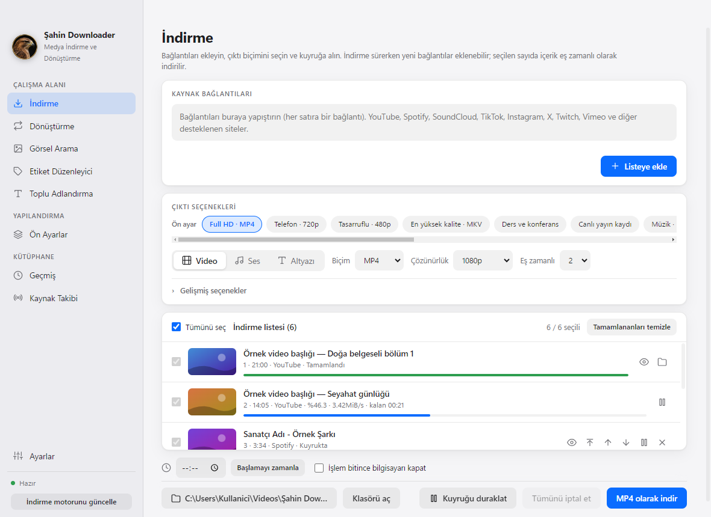
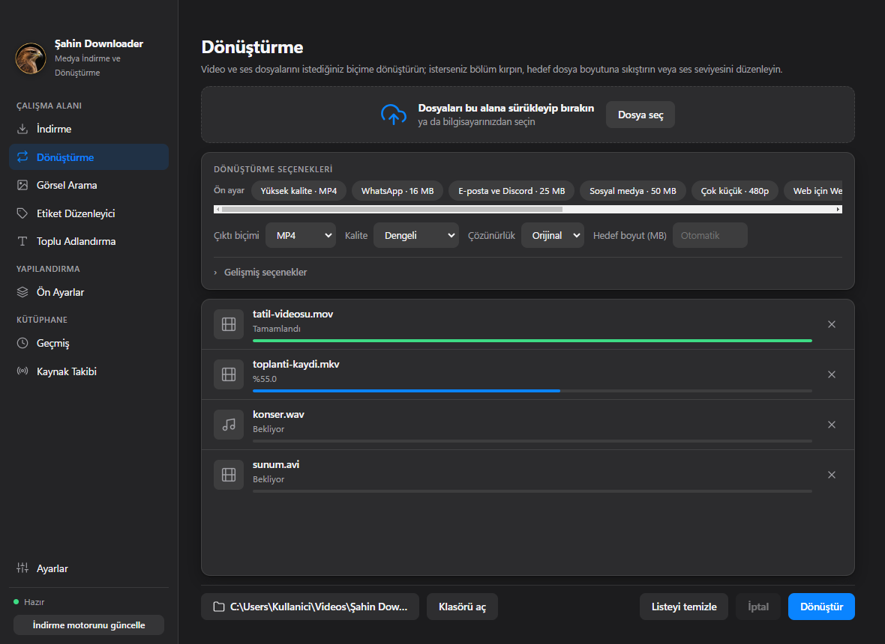
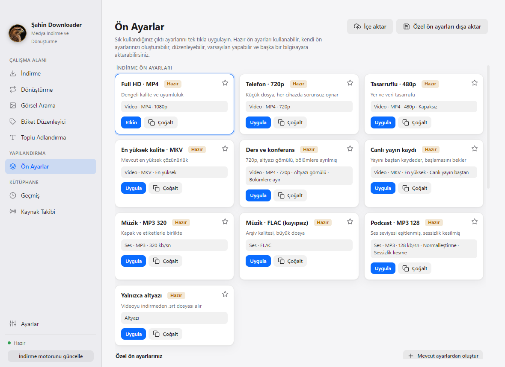
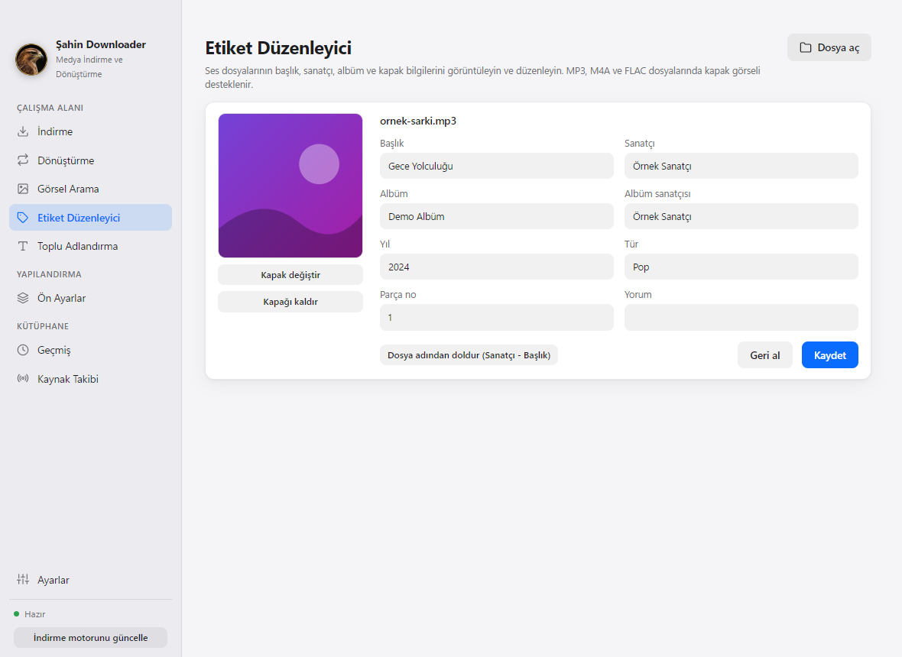
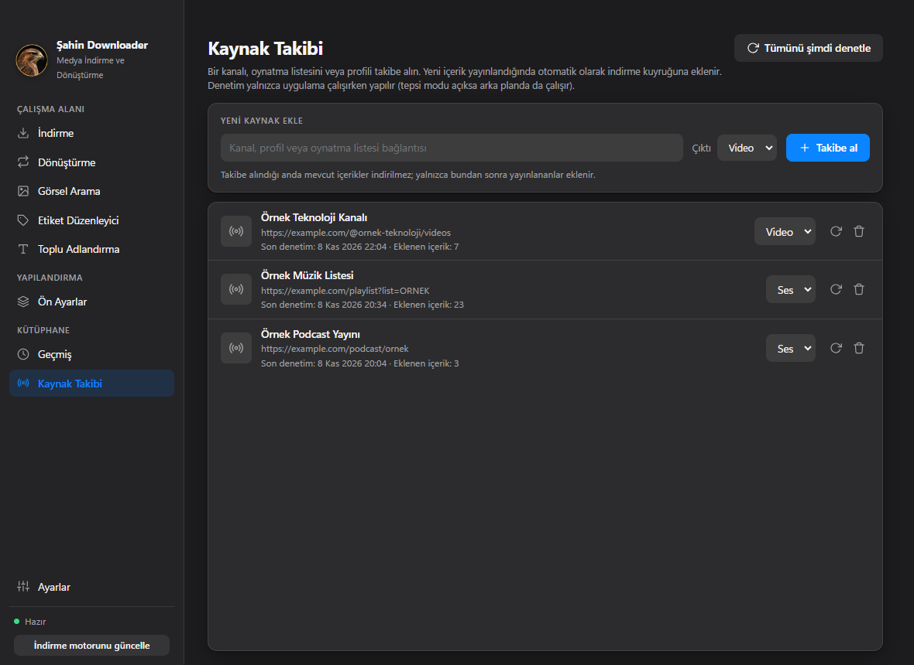
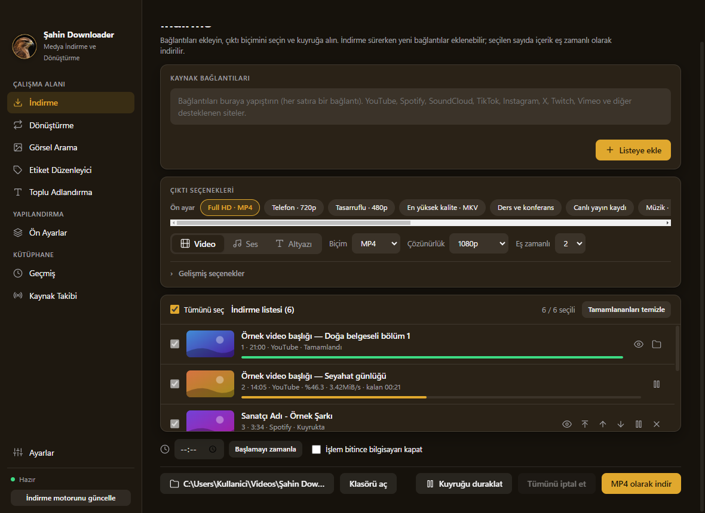
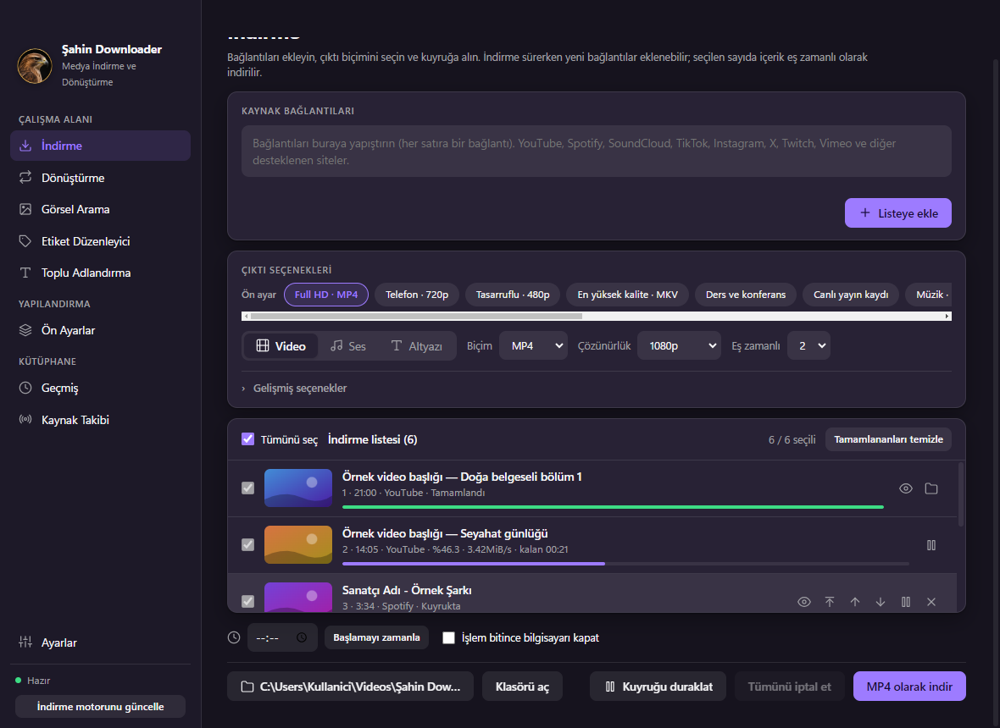
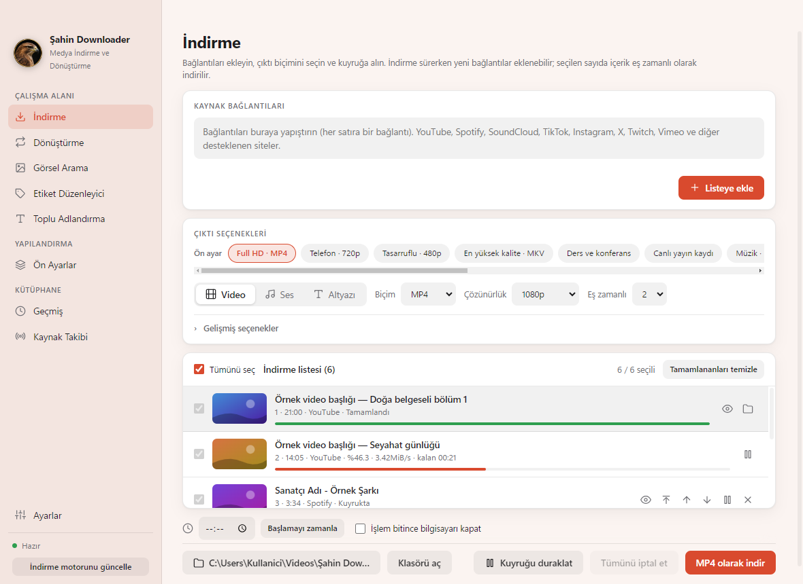
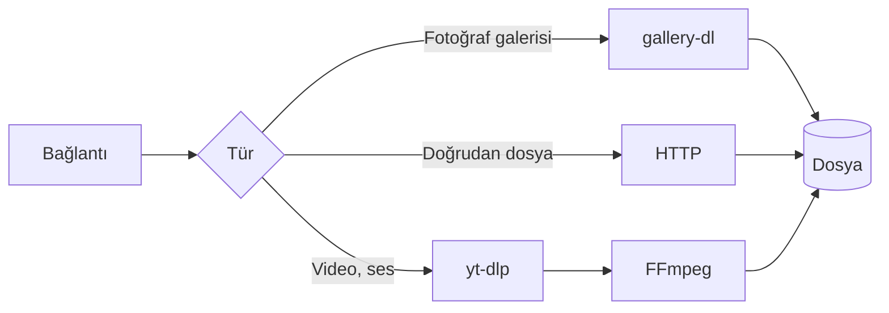

<div align="center">


# Şahin Downloader

**Video, ses ve görselleri tek yerden indirin. Dosyaları dönüştürün, etiketleri düzenleyin.**

Windows, macOS ve Linux için, tek pencerede çalışan hızlı bir masaüstü uygulaması.

[Türkçe](README.md) &nbsp;·&nbsp; [English](README.en.md) &nbsp;·&nbsp; [Deutsch](README.de.md)

<br>

[](https://github.com/ugurlutaha07/sahin-downloader/releases/latest) &nbsp; [](https://github.com/ugurlutaha07/sahin-downloader/releases/latest) &nbsp; [](https://github.com/ugurlutaha07/sahin-downloader/releases/latest)

   

<br>



</div>

<br>

## Kısaca

Bir araçla indirip, başka bir araçla dönüştürüp, üçüncüsüyle etiketini düzeltmeye gerek yok. Bağlantıyı yapıştırın, biçimi seçin, kuyruğa alın; gerisini uygulama halleder. İndirme, dönüştürme, etiketleme ve adlandırma aynı pencerede, aynı kuyrukta.

<table>
<tr>
<td width="33%" valign="top">

**İndirme**<br>
YouTube, Spotify, SoundCloud, TikTok, Instagram, X ve yt-dlp'nin desteklediği yüzlerce site. Listeler öğe öğe gelir, istediğinizi seçersiniz.

</td>
<td width="33%" valign="top">

**Dönüştürme**<br>
11 video ve 11 ses biçimi. Dosyayı **hedef boyuta** sıkıştırın: örneğin 25 MB.

</td>
<td width="33%" valign="top">

**Etiket ve adlandırma**<br>
Başlık, sanatçı, kapak görseli. Şablonla toplu adlandırma, önizlemeli ve geri alınabilir.

</td>
</tr>
<tr>
<td width="33%" valign="top">

**Kuyruk**<br>
Eş zamanlı indirme, duraklatma, sürükleyerek sıralama. İndirme sürerken yeni bağlantı ekleyin.

</td>
<td width="33%" valign="top">

**Ön ayarlar ve kaynak takibi**<br>
Sık kullandığınız ayarı tek tıkla uygulayın. Bir kanalı takibe alın, yeni içerik kendiliğinden insin.

</td>
<td width="33%" valign="top">

**Her boyutta düzgün**<br>
7 renk düzeni, açık ve koyu mod. Dar pencerede simge moduna geçer, her sayfa kaydırılabilir.

</td>
</tr>
</table>

## İndirme ve kurulum

Hazır paketler **[Releases](https://github.com/ugurlutaha07/sahin-downloader/releases/latest)** sayfasındadır. Terminal sevenler için her sistemin komutu aşağıda; [GitHub CLI](https://cli.github.com/) (`gh`) kurulu olmalıdır.

<table>
<tr>
<td width="33%" valign="top">

### Windows
`.exe` kurulum dosyası ya da taşınabilir `.zip`.

```powershell
gh release download `
  --repo ugurlutaha07/sahin-downloader `
  --pattern "*.exe"
```

Çıkan `.exe` dosyasını çalıştırın.

</td>
<td width="33%" valign="top">

### macOS
`.dmg`. Apple Silicon için `arm64`, Intel için `x64`.

```bash
gh release download \
  --repo ugurlutaha07/sahin-downloader \
  --pattern "*mac-arm64.dmg"
open Sahin-Downloader-*.dmg
```

Uygulamayı *Uygulamalar*'a sürükleyin.

</td>
<td width="33%" valign="top">

### Linux
`.AppImage` ya da `.deb` (64 bit).

```bash
gh release download \
  --repo ugurlutaha07/sahin-downloader \
  --pattern "*.AppImage"
chmod +x Sahin-Downloader-*.AppImage
./Sahin-Downloader-*.AppImage
```

`.deb` için: `sudo apt install ./dosya.deb`

</td>
</tr>
</table>

<details>
<summary><b>İlk açılışta uyarı alırsanız</b></summary>

<br>

Paketler henüz kod imzalı değildir; bu nedenle işletim sistemi ilk açılışta uyarı gösterebilir. Uygulamanın kaynak kodu bu depoda açıktır, isterseniz kendiniz derleyebilirsiniz.

- **Windows:** SmartScreen uyarısında *Ek bilgi*, ardından *Yine de çalıştır* seçeneğini kullanın.
- **macOS:** Uygulamaya sağ tıklayıp **Aç**'ı seçin. "Hasarlı" uyarısı görürseniz Terminal'de şunu çalıştırın:
  ```bash
  xattr -dr com.apple.quarantine "/Applications/Şahin Downloader.app"
  ```
- **Linux:** AppImage'a `chmod +x` ile çalıştırma izni vermeniz yeterlidir.

</details>

### Kaynaktan çalıştırma (Git)

Gereksinimler: [Git](https://git-scm.com/) ve [Node.js](https://nodejs.org/) 20 veya üzeri.

```bash
git clone https://github.com/ugurlutaha07/sahin-downloader.git
cd sahin-downloader
npm install
npm start
```

İlk açılışta indirme motoru (yt-dlp) kendiliğinden yüklenir. Galeri motoru ilk kullanımda yüklenir; ffmpeg pakete dahildir.

```bash
npm test            # birim testleri (ağ ve ffmpeg gerekmez)
npm run dist:win    # Windows: kurulum (.exe) ve taşınabilir .zip   (Windows üzerinde)
npm run dist:mac    # macOS: .dmg, arm64 ve x64                     (macOS üzerinde)
npm run dist:linux  # Linux: .AppImage ve .deb                      (Linux üzerinde)
```

Bir sürüm etiketi gönderildiğinde (`git tag v2.0.1 && git push origin v2.0.1`) **GitHub Actions** üç sistemin paketlerini derler ve Releases sayfasına ekler.

## Ekran görüntüleri

<table>
<tr>
<td width="50%"><br><sub><b>İndirme</b> · açık tema</sub></td>
<td width="50%"><br><sub><b>Dönüştürme</b> · koyu tema</sub></td>
</tr>
<tr>
<td width="50%"><br><sub><b>Ön ayarlar</b> · açık tema</sub></td>
<td width="50%"><br><sub><b>Görsel arama</b> · koyu tema</sub></td>
</tr>
<tr>
<td width="50%"><br><sub><b>Etiket düzenleyici</b> · açık tema</sub></td>
<td width="50%"><br><sub><b>Kaynak takibi</b> · koyu tema</sub></td>
</tr>
</table>

<details>
<summary><b>7 renk düzeni</b> (Klasik, Kartal, Okyanus, Orman, Gün Batımı, Ametist, Grafit)</summary>

<br>

<table>
<tr>
<td><br><sub>Kartal</sub></td>
<td><br><sub>Ametist</sub></td>
<td><br><sub>Gün Batımı</sub></td>
</tr>
</table>

Tüm görüntüler [`docs/screenshots`](docs/screenshots) klasöründedir.

</details>

## Nasıl çalışır



1. **Yapı.** Uygulama Electron üzerinde çalışır. Dosya, ağ ve alt süreç işlemlerini ana süreç yürütür; arayüz yalnızca güvenli bir köprü üzerinden ana süreçle konuşur. Bağlam yalıtımı açıktır, arayüze doğrudan Node.js erişimi verilmez.
2. **İndirme.** Bağlantı türüne göre video ve ses için [yt-dlp](https://github.com/yt-dlp/yt-dlp), fotoğraf galerileri için [gallery-dl](https://github.com/mikf/gallery-dl), doğrudan dosyalar için HTTP kullanılır. İndirme motoru ilk açılışta indirilir ve günde bir kez güncellenir.
3. **İşleme.** İndirilen akışlar [FFmpeg](https://ffmpeg.org/) ile birleştirilir, dönüştürülür, kırpılır; kapak ve etiketler dosyaya işlenir.
4. **Gizlilik.** Ayarlar, geçmiş ve takip listesi yalnızca bilgisayarınızda tutulur. Uygulama kullanımınıza ilişkin veriyi geliştiricilere göndermez.

> **Spotify hakkında:** Spotify içerikleri DRM ile korunduğundan doğrudan indirilemez. Şarkı adı ve sanatçı bilgisiyle eşleşen kaynaktan alınır; ad, sanatçı ve kapak bilgisi dosyaya işlenir.

<details>
<summary><b>Veri konumu ve sorun giderme</b></summary>

<br>

| Sistem | Ayarlar ve geçmiş |
| --- | --- |
| Windows | `%APPDATA%\Şahin Downloader` |
| macOS | `~/Library/Application Support/Şahin Downloader` |
| Linux | `~/.config/Şahin Downloader` |

- **YouTube'da "oturum doğrulaması" uyarısı:** Ayarlar → Hesap erişimi bölümünden bir tarayıcı oturumu seçin. Chrome ve Edge'in yeni sürümlerinde çerezler okunamayabilir; bu durumda Firefox'u veya bir `cookies.txt` dosyasını kullanın.
- **Instagram, X ve LinkedIn içeriği alınamıyor:** Bu siteler çoğu zaman oturum ister; yukarıdaki oturum ayarını kullanın.
- **İndirmeler bir gün çalışmayı bırakırsa:** Siteler sık değişir. Ayarlar → *Şimdi güncelle* ile indirme motorunu yenileyin.
- **Hedef boyut:** MP4, MKV, MOV, M4V, FLV, TS ve ses biçimlerinde kullanılabilir.

</details>

## Yasal uyarı

Bu uygulama yalnızca telif haklarının size ait olduğu veya indirilmesine izin verilen içerikler için kullanılmalıdır. İçerik sağlayıcıların hizmet koşullarına ve yürürlükteki mevzuata uymak kullanıcının sorumluluğundadır. Yazarlar, uygulamanın kötüye kullanımından sorumlu tutulamaz.

## Lisans ve üçüncü taraf bileşenler

Bu projenin kodu [MIT](LICENSE) lisansıyla sunulur. Aşağıdaki bileşenlerin lisansları ayrıca geçerlidir:

| Bileşen | Lisans | Not |
| --- | --- | --- |
| [Electron](https://github.com/electron/electron) | MIT | Chromium ve Node.js bileşenlerini içerir |
| [Node.js](https://nodejs.org/) | MIT | YouTube için JavaScript çalıştırıcısı olarak pakete eklenir |
| [yt-dlp](https://github.com/yt-dlp/yt-dlp) | Unlicense | Çalışma zamanında indirilir |
| [gallery-dl](https://github.com/mikf/gallery-dl) | GPL-2.0 | Çalışma zamanında indirilir |
| [FFmpeg](https://ffmpeg.org/) (`ffmpeg-static`) | GPL-3.0-or-later | Dağıtımlarda lisans koşullarını gözetin |
| [electron-builder](https://github.com/electron-userland/electron-builder) | MIT | Yalnızca paket oluşturmada kullanılır |

<br>

---

<div align="center">

## Geliştiriciler

<table>
<tr>
<td align="center" width="50%">

**Taha Uğurlu**<br><br>

[](https://www.linkedin.com/in/taha-u%C4%9Furlu-367229434)
[](https://github.com/ugurlutaha07)

</td>
<td align="center" width="50%">

**Şahin Kerse**

</td>
</tr>
</table>

<br>

İşinize yaradıysa depoya bir yıldız bırakın. Bir şey bozuk çıkarsa ya da aklınıza bir fikir gelirse **[Issues](https://github.com/ugurlutaha07/sahin-downloader/issues)** sayfasından yazın.<br>
İyi indirmeler.

<sub>© 2026 Taha Uğurlu · MIT Lisansı</sub>

</div>
